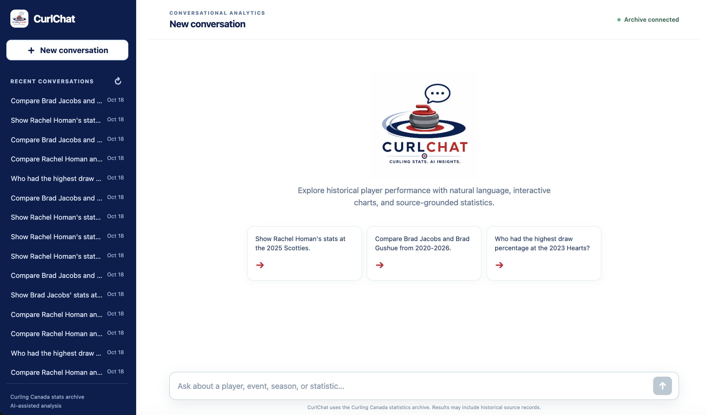
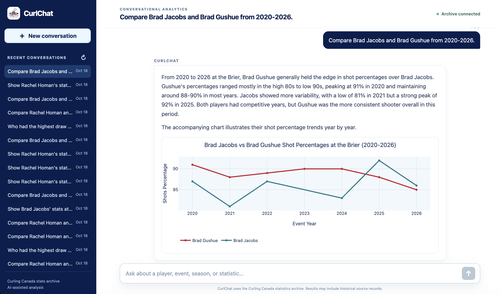
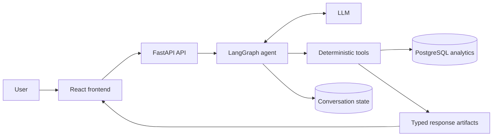

# CurlChat


CurlChat lets users explore Curling Canada player statistics through natural-language questions, source-grounded answers, and interactive visualizations.

## Highlights

- Conversational analysis over structured PostgreSQL data
- LangGraph orchestration with deterministic tools and services
- Streaming FastAPI responses with interactive Plotly charts
- Persistent multi-turn conversations

## From question to insight

Start a new conversation with a natural-language question, or choose a suggested prompt.



CurlChat compares player performance using source-grounded statistics and an interactive trend chart.



## Architecture

The LLM interprets requests and orchestrates tools; deterministic services handle
player and event matching, safe read-only access to statistics, and the charts
and tables displayed in the interface.



See the [architecture documentation](docs/01-architecture.md), [agent design](docs/04-agent.md), and [tool boundaries](docs/05-tools.md) for implementation details.

## Project structure

* `backend` — FastAPI application, agent orchestration, deterministic services, data models, and tests.
* `frontend` — React, TypeScript, and Vite chat interface.
* `docs` — architecture and implementation source of truth.
* `assets` — shared brand assets used by the README and frontend.

See the [project overview](docs/00-project-overview.md).

## Run it locally with Docker

This project is intended to be easy to review and run on a local machine. Docker Compose starts PostgreSQL, the FastAPI application, a production-style Nginx frontend, and Phoenix for optional local tracing. The frontend is available at [http://localhost:5173](http://localhost:5173); its Nginx container serves the Vite production build and proxies both ordinary API requests and streaming responses to the backend.

### Prerequisites

* [Docker Desktop](https://www.docker.com/products/docker-desktop/) (including Docker Compose)
* an OpenAI API key
* Git

The statistics archive remains a separate public repository: [Curling Canada Stats Archive](https://github.com/ccacurling/curling-canada-stats-archive). It is mounted read-only into a one-time importer container; no archive data is copied into this repository or image.

### First run

Clone both repositories, ideally as sibling directories:

```bash
git clone <this-repository-url> Curling-Stats-AI
git clone https://github.com/ccacurling/curling-canada-stats-archive.git curling-canada-stats-archive
cd Curling-Stats-AI
```

Create the local environment file. Set `OPENAI_API_KEY`, and set `ARCHIVE_PATH` to the absolute path of the separate archive checkout.

```bash
cp .env.example .env
```

For example:

```dotenv
OPENAI_API_KEY=your-key
ARCHIVE_PATH=/absolute/path/to/curling-canada-stats-archive
```

`OPENAI_AGENT_MAX_COMPLETION_TOKENS` and `OPENAI_SQL_MAX_COMPLETION_TOKENS`
independently control the model completion budgets for the conversational agent
and structured SQL generator. `OPENAI_AGENT_REASONING_EFFORT` and
`OPENAI_SQL_REASONING_EFFORT` independently control their reasoning depth. The
completion-token defaults are 800 and 600. Reasoning-effort settings apply only
to GPT-5-family models; `gpt-4.1-mini` receives no reasoning-effort parameter.
`ANALYTICS_STATEMENT_TIMEOUT_MS` defaults to 5000 and limits each generated
analytics statement at the PostgreSQL server.

Build and start the application stack, then load the archive once:

```bash
docker compose up --build -d
docker compose --profile import run --rm importer
```

The importer is deterministic and safe to run again after updating the archive. It is deliberately separate from `docker compose up`, so starting the application never silently downloads or changes data.

Open these local services:

* [CurlChat](http://localhost:5173)
* [FastAPI interactive API docs](http://localhost:8000/docs)
* [Phoenix tracing UI](http://localhost:6006) (tracing is disabled by default)

Stop the stack with `docker compose down`. PostgreSQL and Phoenix data remain in named Docker volumes. To intentionally start again with empty local data, run `docker compose down -v`, then repeat the import command.

### Development mode

The Docker stack uses Nginx to serve a production Vite build. For frontend iteration, run only the supporting services with `docker compose up -d postgres phoenix`, start the backend using the commands in the backend README, then run `pnpm install` and `pnpm dev` from `frontend`. Vite's development server serves the frontend on its own and proxies `/api` to FastAPI; it is not part of the Docker stack.
